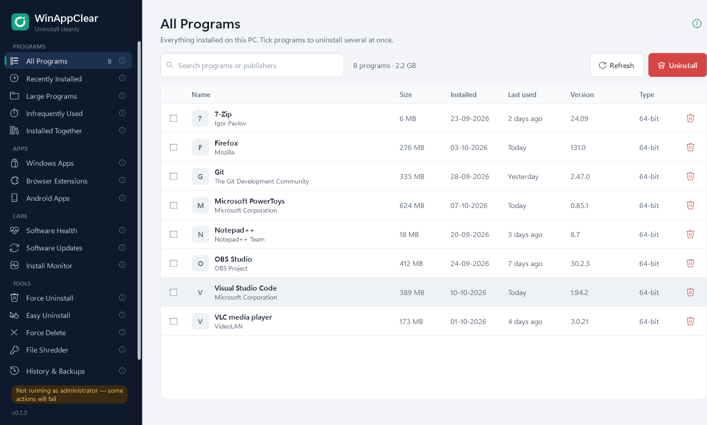

# WinAppClear

**An open-source Windows uninstaller for removing apps and reviewing what they leave behind.**

WinAppClear runs a program's own uninstaller, scans for leftover files and registry entries, and lets you choose what to clean up. It also includes installation logging, backups, and tools for managing unwanted apps and background activity. Built with C#/.NET 8 and WPF; licensed under [MIT](LICENSE).

**Microsoft Store preparation:** source version 0.1.5 includes the search alignment/count fix, an offline MSI build, signature verification, actual-interface listing assets and submission documentation. It is not published or certified in Microsoft Store yet. Start with [the final five steps](docs/store/FINAL-FIVE-STEPS.md), [packaging instructions](packaging/README.md), and [latest validation](docs/store/SEARCH-FIX-0.1.5.md). Existing GitHub release downloads below remain version 0.1.3 until the signed release is published.

<p align="center">
  
  <br />
  <sub>The actual WinAppClear interface, shown with sample program data.</sub>
</p>

<p align="center">
  <a href="https://github.com/ARYANJATHAR/WinAppClear/releases/latest">Download the latest release</a>
  &nbsp;·&nbsp;
  <a href="#run-from-source">Run from source</a>
  &nbsp;·&nbsp;
  <a href="https://github.com/ARYANJATHAR/WinAppClear/issues">Report an issue</a>
</p>

## Features

| Feature | What it does |
| --- | --- |
| Program uninstall | Remove one desktop app or select several for batch uninstall, then review leftovers. |
| Program filters | Find recently installed, large, infrequently used, and potentially bundled programs. |
| Install Monitor & logged programs | Record before/after installation snapshots, inspect changes, and use the log for later cleanup. Start recording before installing. |
| Windows apps & extensions | Review supported Microsoft Store apps and unwanted browser add-ons. |
| Software Health | Review leftovers, broken uninstall entries, old installers, caches, notifications, and background activity. |
| Software Updates | Check and install supported updates through Windows Package Manager (`winget`). |
| Easy / Force Uninstall | Identify software from its window or review a broken installation's remaining files. |
| Force Delete & File Shredder | Remove stubborn files or overwrite disposable files before deletion. |
| History & Backups | Review removals and restore items WinAppClear backed up. |
| Android apps | Manage apps on a connected phone through ADB and USB debugging. |

Hover over an info icon beside a sidebar section, or click the page's top-right info button, for help and prerequisites.

## Download and install

**Requirements:** Windows 10/11 x64 and administrator access. The published EXE includes .NET; you do not need to install .NET separately. This release is not built for 32-bit Windows, Windows ARM64, macOS, or Linux.

### Portable EXE — quickest option

1. Open the [latest release](https://github.com/ARYANJATHAR/WinAppClear/releases/latest).
2. Under **Assets**, download **[WinAppClear.exe](https://github.com/ARYANJATHAR/WinAppClear/releases/latest/download/WinAppClear.exe)**.
3. Save it in a folder of your choice and double-click it.
4. Accept the Windows administrator prompt.

There is no setup wizard. The portable EXE runs by itself.

### ZIP package

1. Download **[WinAppClear-0.1.3-win-x64.zip](https://github.com/ARYANJATHAR/WinAppClear/releases/download/v0.1.3/WinAppClear-0.1.3-win-x64.zip)** from the release assets.
2. Extract it into a normal folder.
3. Run **WinAppClear.exe** from the extracted folder and accept the administrator prompt.

Choose the EXE or the named Windows ZIP to run the app. GitHub's automatically generated **Source code** archives contain the project source and must be built first.

### Verify a download (optional)

Download `SHA256SUMS.txt` from the same release. In PowerShell:

```powershell
Get-FileHash .\WinAppClear.exe -Algorithm SHA256
```

Compare the result with the EXE's entry in the checksum file. A ZIP hash is included too.

## Basic use

1. Open **All Programs** and search for the app you want to remove.
2. Select one app, or tick several, then click **Uninstall**.
3. Follow each program's own uninstaller.
4. Review the leftover scan and select what to remove. Keep high-confidence-only selection enabled initially.
5. Use **History & Backups** to restore backed-up items. Restoring leftovers does not reinstall an entire application.

**Installed Together** flags possible bundles using registry timestamps and publisher differences; it does not prove software was bundled or unwanted. **Install Monitor** currently uses manual recording, not automatic background monitoring. Other activity during a recording can appear in its results.

## Run from source

### Prerequisites

- Windows x64.
- [Git](https://git-scm.com/downloads/win).
- [.NET 8 SDK](https://dotnet.microsoft.com/en-us/download/dotnet/8.0) — install the **SDK**, not just the runtime.
- Optional: Visual Studio 2022 with the **.NET desktop development** workload.

Open **PowerShell as administrator**, then run:

```powershell
git clone https://github.com/ARYANJATHAR/WinAppClear.git
cd WinAppClear

dotnet restore WinAppClear.sln
dotnet build WinAppClear.sln -c Release
dotnet run --project src/WinAppClear.App/WinAppClear.App.csproj -c Release --no-build
```

The app requests administrator privileges. An elevated terminal avoids elevation problems when launching through the SDK.

Alternatively, open `WinAppClear.sln` in Visual Studio, set **WinAppClear.App** as the startup project, select **Release / Any CPU**, and run from an elevated Visual Studio instance. The projects target x64 internally.

### Run tests

```powershell
dotnet test tests/WinAppClear.Core.Tests/WinAppClear.Core.Tests.csproj -c Release
```

Release 0.1.3 was validated with **68 passing tests** and a startup check of the published EXE. Tests use isolated temporary data and do not uninstall real programs. See [TESTING.md](TESTING.md) for coverage and limits.

### Build a portable EXE

```powershell
dotnet publish src/WinAppClear.App/WinAppClear.App.csproj -c Release -p:PublishProfile=Portable -o artifacts/WinAppClear-0.1.3-win-x64
```

Output: `artifacts/WinAppClear-0.1.3-win-x64/WinAppClear.exe`.

### Command-line diagnostics

The CLI lists and scans; it does not remove programs:

```powershell
dotnet run --project src/WinAppClear.Cli/WinAppClear.Cli.csproj -- list
dotnet run --project src/WinAppClear.Cli/WinAppClear.Cli.csproj -- scan "program name"
```

## Settings and optional dependencies

Settings, history, logs, and backups normally live in `%LOCALAPPDATA%\WinAppClear`. Upgrades reuse an existing `%LOCALAPPDATA%\ClearOut` folder if the new folder does not exist, preserving older settings and absolute backup paths.

- **Software Updates:** requires `winget` and an internet connection.
- **Android Apps:** requires Android Platform Tools (`adb`), USB debugging, and phone authorization.
- **Restore points:** depend on Windows System Protection and administrator access.

To stop using the portable app, close it and delete its EXE or extracted package. Saved app data remains separately; keep that folder if you still need its backups.

## Project structure

```text
src/WinAppClear.App/           WPF desktop interface
src/WinAppClear.Core/          Inventory, uninstall, cleanup, safety, and backups
src/WinAppClear.Cli/           Read-only diagnostic CLI
tests/WinAppClear.Core.Tests/  Isolated regression and WPF smoke tests
docs/images/                  README screenshots
```

Generated `bin`, `obj`, `artifacts`, and `TestResults` folders are excluded from Git. Download binaries from **Releases**, or build locally.

## Status and contributing

WinAppClear is an early-stage project. Automated tests and startup checks pass, but real installer removal, Store/browser/Android integrations, updates, restore points, and reboot deletion still need broader testing in disposable Windows VMs. Force Delete and File Shredder do not provide normal cleanup backups. Overwriting files does not guarantee erasure on SSDs.

Bug reports, documentation improvements, tests, and pull requests are welcome. Include your Windows version, WinAppClear version, reproduction steps, and a redacted error log when reporting a bug. Avoid posting personal paths or sensitive data. Test destructive changes against disposable fixtures or a VM.

## License

[MIT](LICENSE) — copyright © 2026 ARYANJATHAR. Third-party dependencies retain their respective licenses.
